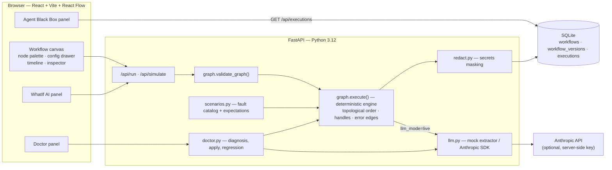
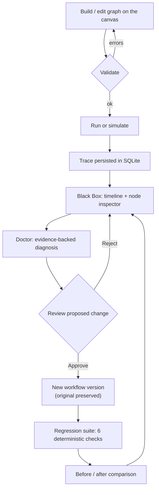
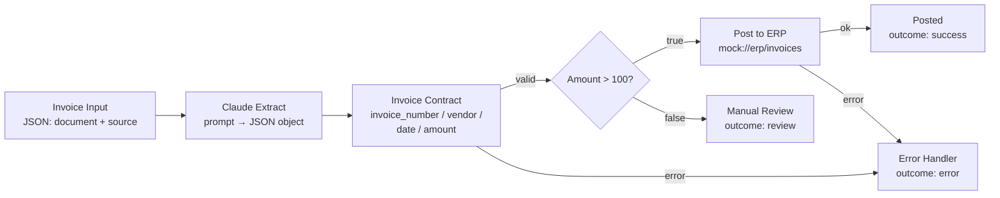
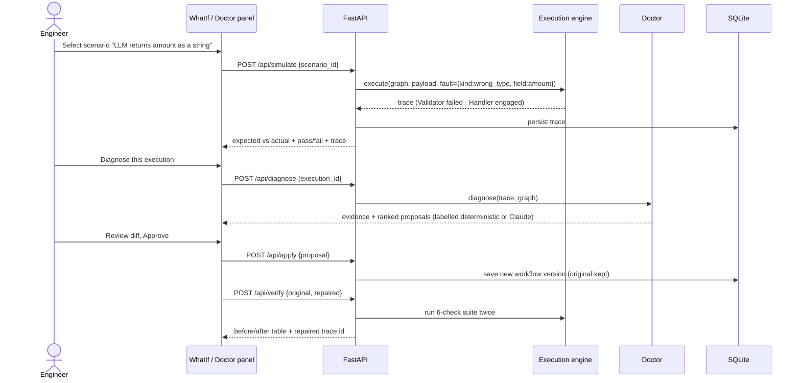
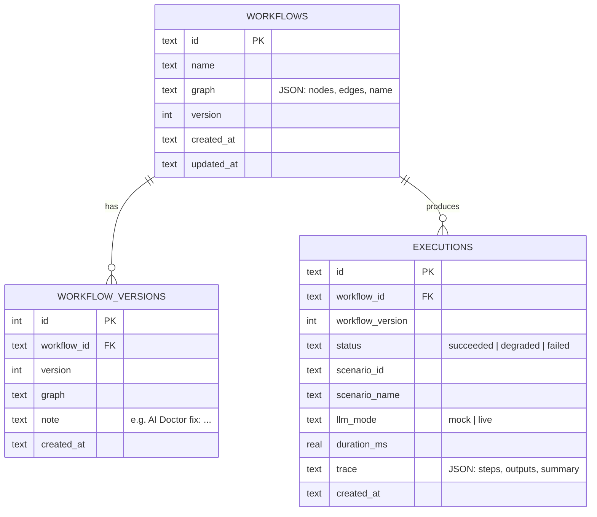
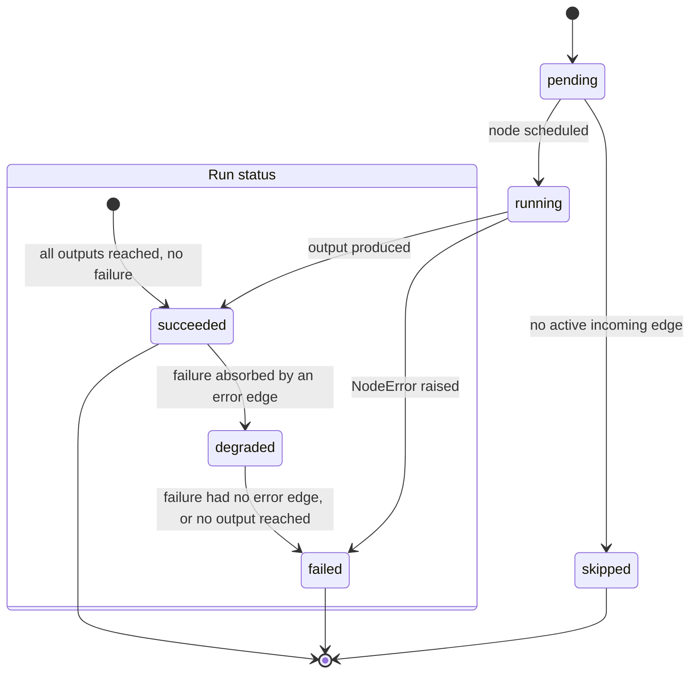
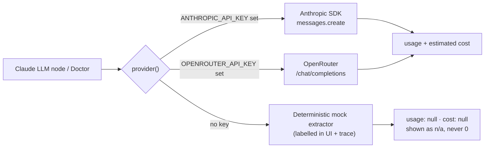

# FlowForge AI — Plan

FlowForge AI is one platform with three capabilities that share a single workflow model and a single
execution record:

| Capability | Role in the loop |
|---|---|
| **FlowForge** — visual builder | Build / configure the graph and run it |
| **WhatIf AI** — failure simulation | Simulate deterministic failures before trusting the workflow |
| **Agent Black Box** — observability | Observe every run: timeline, node I/O, errors, usage |
| **AI Workflow Doctor** — repair | Diagnose from the trace, propose a fix, get approval, verify by regression |

The central experience is the loop: **Build → Simulate → Execute → Observe → Diagnose → Approve → Retest → Compare**.

## 1. System architecture

Key decisions:

- **One execution engine.** WhatIf, manual runs and regression tests all call `graph.execute()`. Simulation is
  not a separate fake path — a scenario sets a fault on a target node and the real executor reacts to it.
- **Determinism is a contract.** No node depends on wall-clock randomness. The mock model's output format is
  derived from the prompt text, so prompt fixes can be verified offline.
- **LLM never decides pass/fail.** Scenario verdicts come from comparing the trace to declared expectations.
  The Doctor's diagnosis is a hypothesis; the regression suite is the judge.

## 2. Unified product workflow

## 3. Example invoice-processing graph

Seeded demo workflow `wf_invoice_demo`: **Input → Claude LLM → Validator → Condition → Output**, plus handler paths.

**The baseline defect (intentional, and the demo's starting point).** The seeded prompt is under-specified —
it asks for JSON but never pins field types or formats. The deterministic mock model therefore returns
`date: "03/14/2025"` and `amount: "$1,250.00"` (a string). The Validator rejects both, the run goes `degraded`
through the Error Handler, and the Doctor proposes tightening the prompt contract. After approval, the model
returns ISO dates and a numeric amount, the posting path runs, and regression coverage goes from 4/6 to 6/6.

### Node contracts

| Node | Input | Output | Failure modes |
|---|---|---|---|
| Input | — | sample JSON payload | config invalid |
| Claude LLM | any JSON | parsed JSON (or raw text) | `malformed_json`, `empty_response`, `timeout`, `api_error`, `refusal` |
| Transform | object | object | `transform_error` (missing source field) |
| Validator | object | same object (pass-through) | `validation_failed` with per-field evidence |
| Condition | object | same object, handle `true`/`false` | `condition_error` |
| HTTP Request | object → JSON body | input + `http_response` | `http_error`, `timeout`, `empty_response`, `config_error` (blocked URL) |
| Failure Simulator | object | mutated object | any injected kind |
| Output | any | any, plus `outcome` | — |

Handles: every node has `out`; Condition has `true`/`false`; every non-input/non-output node has an `error`
handle. Connections to unknown handles, self-connections, duplicates and cycles are rejected by
`validate_graph()` before execution.

## 4. Failure simulation and diagnosis sequence

## 5. Data model

## 6. Execution states

Run status is derived, not asserted: `failed` if any failure was unhandled or no Output ran; `degraded` if a
failure was absorbed by an error edge and an Output still ran; otherwise `succeeded`.

## 7. What is real vs. simulated

| Real | Simulated / mocked |
|---|---|
| Graph validation, execution engine, handle routing, cycles | Claude model itself when no `ANTHROPIC_API_KEY` is set |
| Validator semantics, transforms, conditions | Downstream ERP (`mock://erp/invoices`) |
| Fault injection through real node code | Scenario latency (scaled out with `FLOWFORGE_FAST=1` in tests) |
| SQLite persistence, versioning, regression suite | Token usage/cost when the mock model is used (reported as unavailable, never as 0) |

The UI labels every mocked run (`mock model` chip), every mock-backed metric (`n/a`, "not reported"), and every
injected fault (`simulated`).

## 8. Model providers

`backend/.env` is loaded at package import (`flowforge/config.py`) and never overrides real environment variables.
Anthropic takes precedence when both keys are present.

## 9. Security posture

- `ANTHROPIC_API_KEY` is read only from the server environment; the browser never sees it.
- Traces are passed through `redact.py`: sensitive keys (`api_key`, `token`, `password`, `account_number`, …)
  are masked, and value patterns (Anthropic keys, bearer tokens, IBANs) are replaced before persistence and
  before anything is attached to a Claude diagnosis request.
- HTTP nodes accept only `mock://` URLs or `https://` hosts explicitly listed in `FLOWFORGE_HTTP_ALLOWLIST`;
  DNS results resolving to private, loopback, link-local or reserved addresses are refused, and redirects are
  not followed (SSRF guard).
- No node executes user-supplied code; transforms are a fixed set of declarative operations.
- Applying a Doctor proposal always creates a new version — nothing is deployed or overwritten.

## 10. Roadmap

| Phase | Scope | State |
|---|---|---|
| **P0** | Shell, canvas, node config, engine, WhatIf, Black Box, Doctor, regression compare | ✅ built |
| **P1** | SQLite persistence + version history, token/cost display, scenario catalog, empty/error states | ✅ built |
| P2 | Real integrations, scheduling, collaboration, distributed execution, auth | not started |

### Verification performed

- `pytest` — 24 backend tests (engine, validation, cycles/handles, every scenario, Doctor safety, redaction, SSRF guard).
- `scripts/ui_check.py` — drives the real UI in Chrome via Playwright: loads the canvas, runs the workflow, inspects
  the failing node, runs all WhatIf scenarios, diagnoses, approves the fix, and asserts the regression verdict is
  **6/6 (was 4/6)**, failing on any browser console error. Screenshots land in `screenshots/`.

### Known limitations

- Single-process execution; no queue or distributed workers.
- Workflow versioning is append-only; there is no merge or diff between arbitrary versions.
- Regression suite is the fixed default suite (6 checks), not user-authored.
- Live Claude mode assumes the model can satisfy the JSON contract; if it cannot, the regression suite will
  honestly report a remaining failure.
- The mock model is tailored to the invoice-extraction demo; other prompts return generic JSON derived from
  the payload.
- A WhatIf fault can only be judged where execution reaches its target node. On the un-repaired demo the three
  HTTP scenarios are **blocked** by the validator defect and reported as `blocked`, not as passes or failures.
